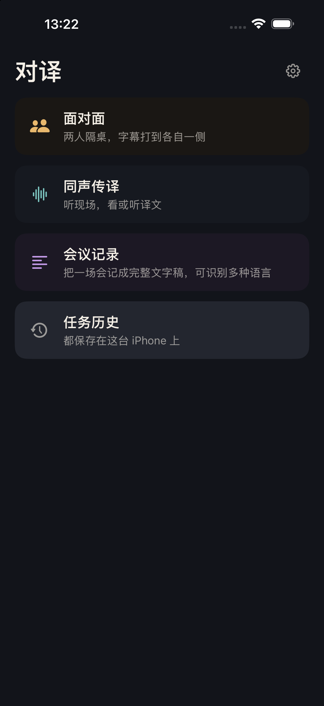
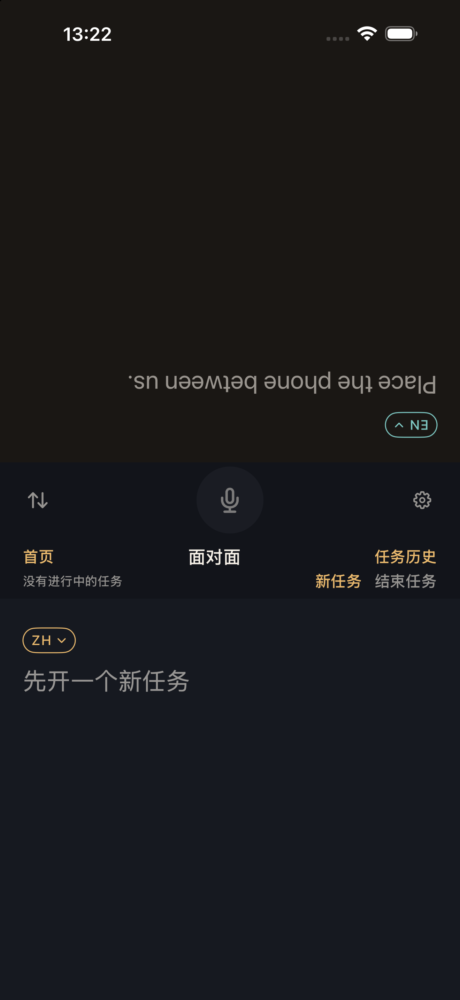
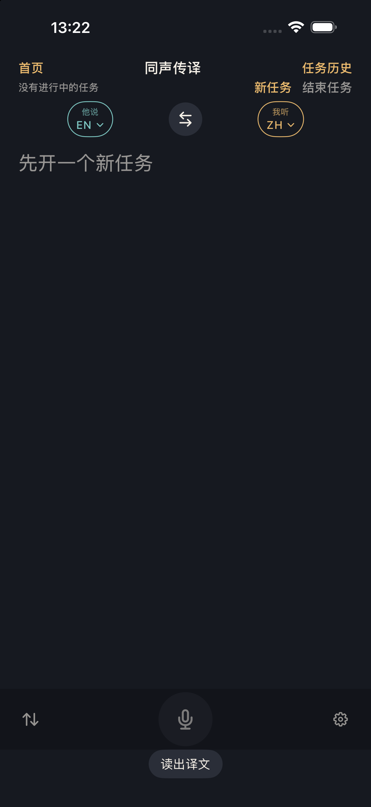
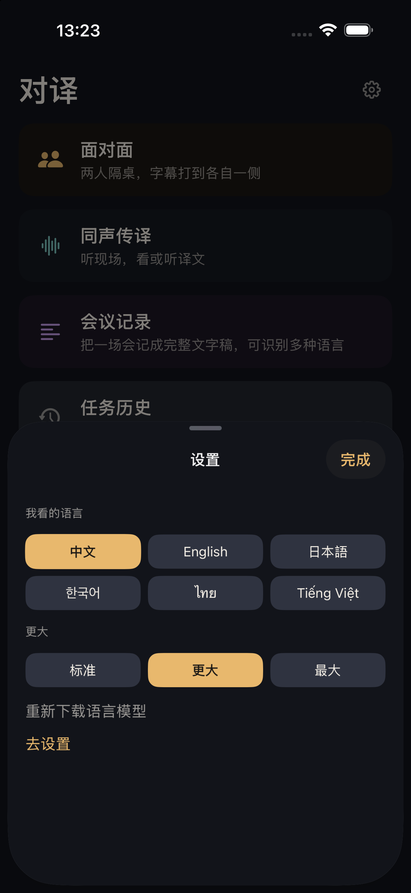

# 对译 Duiyi

[](https://github.com/DavidTeam2008/realtimeTranslatorOptimize/actions/workflows/verify.yml)
[](LICENSE)
[](#完整-ios-环境)

> 端侧 iOS 实时翻译 App：麦克风 → 听写 → `Translation.framework` → 字幕/可选 TTS。
> 同时它是一个**可审计的 Harness Engineering 实践样本**——看一个真实仓库如何让 AI Coding Agent 的"做完了"变得可验证。

[English overview ↓](#english-overview)

## 为什么值得看

- **真实产品，不是 demo**：面对面、同声传译、会议记录三个模块，任务历史、总结、导出都是可用的；全部在设备端完成，无后端、无 API Key、不上传音频。
- **端侧隐私**：听写/翻译依赖系统端侧能力，首次需联网下载系统资源；文本只在本机保存。
- **Harness 可审计**：`AGENTS` 指令树、静态门禁、证据链、PASS/FAIL/UNVERIFIED 三值判定都固化进仓库——"已验证"不是一句自述，而是可被脚本否证的声明（见 [`HARNESS.md`](HARNESS.md)）。
- **可复制**：[`harness-kit/`](harness-kit/README.md) 把指令/门禁/证据抽成项目无关模板（minimal/standard/strict + `harness-init` + 三档端到端验收），同一套机制可在其他仓库 10 分钟接入。

## 功能

- **面对面**：手机平放，上半屏倒字给对方、下半屏正字给自己；双向听写 + 双向翻译。
- **同声传译**：单栏看现场译文，可选戴耳机读出译文；单向听写 + 单向翻译。
- **会议记录**：单语全文稿，会后总结或导出。
- **任务历史**：只有点"结束任务"才写入本机，可回看、总结、导出分享。
- **语言**：中 / 英 / 日 / 韩 / 泰 / 越；仅 iPhone、竖屏。

## 界面

| 首页 | 面对面 | 同声传译 | 设置 |
| --- | --- | --- | --- |
|  |  |  |  |

> 截图来自 iPhone 17 Pro Max / iOS 26.4.1 模拟器；语音链路仍需真机验证。

## 10 分钟快速开始（不需要 Xcode）

```bash
git clone <repo-url> && cd realtimeTranslatorOptimize
make check          # 6 组静态门禁（docs/架构/计数/harness/计划/adapters），约 1s
make verify-static  # 再加证据 schema + 91 个脚本单测 + 67 个 kit 端到端，约 15–25s
```

只依赖 `python3`、`make`、`git`，不需要 Xcode——因此这里能验证规则/结构/证据/代码边界，但**不能运行 App、模拟器或真机**。用 `git clone --depth 1` 浅克隆时先 `git fetch --unshallow`（脚本单测会读取提交历史）。

想把整套 harness 用到自己项目：见 [`harness-kit/`](harness-kit/README.md)（`harness-init` 10 分钟接入）与 [`HARNESS.md`](HARNESS.md) 的「10 步采用指南」。

## 完整 iOS 环境

- macOS + **Xcode 26.4+**（当前验证 27.1）+ iOS 26.4 Simulator；最低 iOS 26.4、仅 iPhone 竖屏；
- 用 Xcode 打开 `Duiyi.xcodeproj`，App / `DuiyiTests` / `DuiyiUITests` 三个 target 改成自己的 Team 与唯一 Bundle ID（工程内 Bundle ID 只是示例）；
- 真机开启开发者模式、信任此 Mac；首次启动按引导选语言、授权麦克风/语音识别、下载端侧资源。

```bash
make build
make test                   # 模拟器单元测试
make test-ui                # 模拟器 UI 测试（语音用例按预期 skip）
harness/tools/device-test.sh   # 真机完整套件（先预热 testmanagerd）
```

签名、真机、已知坑与验证矩阵：[`CONTRIBUTING.md`](CONTRIBUTING.md)、[`references/verification.md`](references/verification.md)。

## 项目结构

```text
Duiyi/
  App/            入口、依赖注入、导航、首页模块注册
  Features/       Home / Conversation / Interpretation / Meeting / History / Onboarding / Shared
  Domain/         纯模型与纯函数（任务、语言、字幕、切句、路由）
  Services/       语音、音频、翻译、TTS、持久化、总结、导出、权限、资源
  DesignSystem/   Tokens、卡片、列表行、安全区
DuiyiTests/       单元测试（Swift Testing）
DuiyiUITests/     启动性能 + 导航 + 同传监听 UI 测试
docs/             产品 / 架构 / 选型 / 路线图 / 决策
references/       Agent 规则细则：契约 / 验证 / 分级与红队
tools/            静态门禁与脚本（docs / 架构 / 计数 / harness / 计划 / 证据）
harness/             计划、证据、审查与真机脚本（过程档案，见 HARNESS.md）
Order/            Release 二进制重排符号表（生成物，启动优化已暂停）
```

## Harness Engineering 在这里怎么落地

| 层 | 机制 | 入口 |
| --- | --- | --- |
| **Guides（前馈）** | `AGENTS.md` 指令树（根 + 嵌套）、`references/` 规则、`.dsh/skills/` 动作卡 | [`AGENTS.md`](AGENTS.md)、[`HARNESS.md`](HARNESS.md) |
| **Sensors（反馈）** | 静态门禁 → 单元/UI → 真机；测试计数、架构铁律、文档预算、计划状态都可机检 | `make check` / `make verify-static` |
| **Evidence（证据）** | 完成声明写 `harness/evidence/*.json`，`make verify-claim` 输出 **PASS / FAIL / UNVERIFIED** | [`HARNESS.md`](HARNESS.md) §5 |
| **独立审查** | 并发/持久化/发布工程改走只读红队；月度 harness 审计 | `.dsh/skills/red-team`、`make harness-audit` |
| **工具适配** | 规则/门禁/证据不绑定工具；DSH 与 Claude Code 适配层 | [`harness/adapters/`](harness/adapters/)、`make adapters-check` |

设计原则：**没有执行载体的规则不写；完成声明必须可证伪；一个事实只有一个真源；能机检就不靠自觉。**

## 测试与验证

- 验证矩阵（哪些改动必须真机、性能口径、skip 白名单）唯一源：[`references/verification.md`](references/verification.md)；
- 测试计数下限与 skip 白名单由 `make check-tests` 机检，删测试会红；
- 真机测试统一入口：`harness/tools/device-test.sh`（先预热 `testmanagerd`，解决 exit 74 / automation 超时）；
- 当前验证状态与证据：见 [`HARNESS.md`](HARNESS.md) §5 与 `harness/evidence/`。

## 文档

| 文档 | 内容 |
| --- | --- |
| [`docs/README.md`](docs/README.md) | **唯一文档索引**与阅读顺序 |
| [`HARNESS.md`](HARNESS.md) | Harness Engineering 系统地图：guides/sensors、证据政策、CI、审计 |
| [`CONTRIBUTING.md`](CONTRIBUTING.md) | 本地开发、签名、测试、门禁、提交与 Agent 协作 |
| [`docs/01-product-design.md`](docs/01-product-design.md) | 当前产品行为：三模块、任务、设置、总结/导出 |
| [`docs/02-architecture.md`](docs/02-architecture.md) | 当前架构：分层、数据链路、并发、持久化（最值得先读） |
| [`docs/03-tech-choices.md`](docs/03-tech-choices.md) | 系统框架选型、理由与明确不选 |
| [`docs/04-roadmap.md`](docs/04-roadmap.md) | P0–P3 问题、验收标准与排期（唯一排期源） |
| [`docs/decisions.md`](docs/decisions.md) | 决策表 D1–D7 与 2026-11 工程决策（唯一决策源） |
| [`docs/harness-scorecard.md`](docs/harness-scorecard.md) | Harness 五子系统评分卡与独立复评记录 |
| [`AGENTS.md`](AGENTS.md) | AI Agent 冷启动入口 |

## 当前状态

- 三个模块、任务历史、总结、导出、6 语种、引导流程均已落地；
- 主要技术债：语音引擎全局仲裁、长会话数据留存、SwiftData 写放大、翻译队列积压、导出竞态（详见 [`docs/04-roadmap.md`](docs/04-roadmap.md)）；
- 启动 200ms 目标经对照实验判定不可达（空壳 App 地板约 210ms），启动微优化已暂停；完整证据链见 [`docs/case-startup-performance.md`](docs/case-startup-performance.md)；
- Harness 侧已完成 Phase 0/1（静态门禁、证据三值、CI、skills），Phase 2+ 在做（见 [`HARNESS.md`](HARNESS.md)）。

## 隐私

默认不保存音频；文本只在 settled / 暂停 / 结束时写入本机；无后台音频模式；无自建网络服务、无第三方 SDK、无 API Key。总结优先用 Apple 智能，设备不支持时回退到本地摘要并如实提示。

## License

[MIT](LICENSE)

---

## English overview

**Duiyi** is an on-device iOS real-time translation app: microphone → speech transcription → Apple `Translation.framework` → captions / optional TTS. Three modes (face-to-face, simultaneous interpretation, meeting notes), local SwiftData history, no backend, no API keys, no audio upload.

It also serves as an **auditable Harness Engineering case study** for AI coding agents:

- **Guides**: an `AGENTS.md` instruction tree, `references/` rule details, and project-level skills.
- **Sensors**: fast static gates (docs / architecture / test-baseline / plan / evidence), unit & UI tests, real-device verification, and a three-valued claim verifier.
- **Evidence**: completion claims must map to evidence JSON; `make verify-claim` returns PASS / FAIL / UNVERIFIED. Claims without evidence count as unverified.
- **Reusable kit**: [`harness-kit/`](harness-kit/README.md) extracts the same guides / sensors / evidence into project-agnostic profiles (minimal / standard / strict) with a `harness-init` scaffolder and end-to-end acceptance tests.

No Xcode needed to check the repository:

```bash
make check          # 6 static gate groups, ~1s
make verify-static  # + evidence schema + 91 script tests + 67 kit e2e tests, ~15-25s (use a full clone)
```

Full iOS build requires macOS + Xcode 26.4+ and an iPhone running iOS 26.4+; see [`CONTRIBUTING.md`](CONTRIBUTING.md). Start with [`HARNESS.md`](HARNESS.md) for the harness map, [`docs/02-architecture.md`](docs/02-architecture.md) for the architecture, and [`docs/04-roadmap.md`](docs/04-roadmap.md) for the roadmap.

License: MIT.
